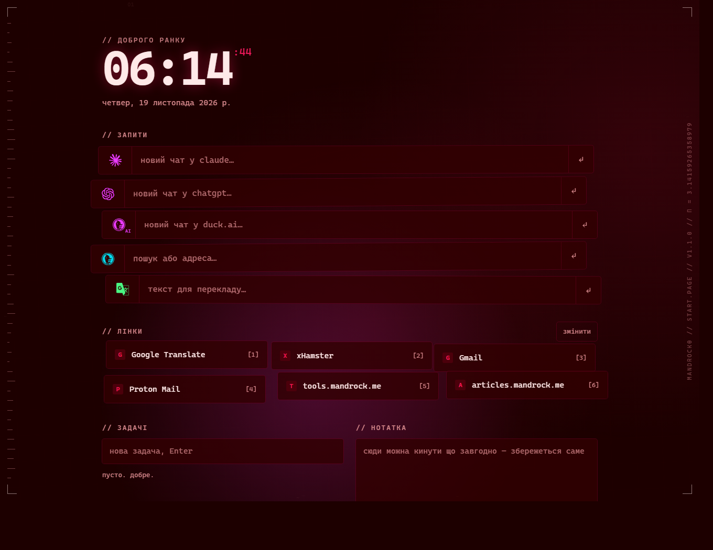

<div align="center">

# `mandrock0 // start`

**Мінімалістична стартова сторінка для Microsoft Edge (і будь-якого Chromium).**
Компактний годинник, швидкі запити в AI-чати, пошук, лінки, задачі й нотатка — і нічого зайвого.




</div>

---

## Що всередині

### `// запити`
П'ять полів вводу, підписаних лише іконками сервісів (кольори за роллю: фіолетовий — AI-чат, блакитний — пошук, зелений — переклад). Пишеш текст, тиснеш **Enter**, потрібний сервіс відкривається вже з запитом.

| Поле | Куди веде |
|---|---|
| **claude** | новий чат на `claude.ai/new?q=…` |
| **chatgpt** | новий чат на `chatgpt.com/?q=…` |
| **duck.ai** | новий чат на `duck.ai/?q=…` |
| **duckduckgo** | пошук; якщо ввести адресу (`example.com/page`) — відкриє її напряму; `!bangs` працюють |
| **переклад → uk** | Google Translate з уже вставленим текстом (auto → українська) |

`Ctrl`+`Enter` (або `Shift`+`Enter`) відкриває результат у новій вкладці.

### Швидкий доступ

Поруч із запитами на широкому екрані розташований компактний годинник. Під годинником є розділена кнопка **read / drafts**, **kb-flow**, **tools**, **articles**, **runs** і **password**.

### `// лінки`
Google Translate, xHamster, Gmail, Proton Mail, tools.mandrock.me, articles.mandrock.me. Біля кожного — favicon сайту, а якщо його нема, то літера.
Кнопка **змінити** дозволяє прибрати їх або додати свої. Рядок «часто відвідувані» підтягується з Edge автоматично.

### `// задачі` та `// нотатка`
Чекліст і поле для швидкої нотатки з лічильником символів. Лічильник показує активні задачі, а виконані можна прибрати однією кнопкою. Усе зберігається локально й переживає перезапуск браузера.

### Гарячі клавіші

| Клавіша | Дія |
|---|---|
| `c` `g` `d` `s` `t` | фокус у полі claude / chatgpt / duck.ai / пошук / переклад |
| `a` | фокус на першій задачі або полі нової задачі |
| `n` | фокус у нотатці |
| `1`–`9` | відкрити відповідний лінк |
| `Esc` | вийти з поля вводу |

Клавіші спрацьовують, лише коли курсор не в полі вводу.

---

## Дизайн

Сторінка зібрана за конвенцією **mandrock0**: dark-only, токени й акценти з системи, один колір glow на вид, рольові кольори несуть зміст (фіолетовий — AI-чат, блакитний — пошук, зелений — переклад).

Окремі речі, що роблять її живою:

- **Глітч `shear`.** Годинник при появі один раз «зсувається» горизонтальними смугами. Чотири кроки по 334 мс, без мерехтіння.
- **Недбала розстановка.** Рядки запитів зсунуті й злегка нахилені; плитки лінків стоять рівно по сітці. Кут і зсув беруться з цифр числа π, тож композиція завжди та сама, а не випадкова. У фокусі рядок вирівнюється.
- **Debris на полях.** Рамки-кропмарки по кутах, лінійка, де довжина рисок — цифри π, і вертикальний підпис. Усе це `aria-hidden` і живе лише на краях.
- **Ambient-шар** у профілі `calm`: сітка, м'які плями світла, символи на краях.
- Одним кліком у футері змінюється акцент: `crimson` → `purple` → `cyan` → `lime`.

`prefers-reduced-motion` вимикає глітч і рух. Усі інтерактивні елементи мають видимий `:focus-visible`.

---

## Встановлення в Edge

1. Завантаж `mandrock0-start-<версія>.zip` зі [сторінки Releases](../../releases/latest) і розпакуй у постійну папку (Edge читає розширення звідти, тож не видаляй її).
2. Відкрий `edge://extensions`.
3. Увімкни **Режим розробника** (Developer mode).
4. Натисни **Завантажити розпаковане** (Load unpacked) і вибери розпаковану папку.
5. Відкрий нову вкладку.

Edge може попросити підтвердити, що розширення замінює сторінку нової вкладки. Залиш його ввімкненим.

> **Домашня сторінка й сторінка запуску.** Розширення підміняє сторінку *нової вкладки*. Щоб вона ж відкривалась і при старті Edge, відкрий `edge://settings/startHomeNTP` і вибери «Відкрити сторінку нової вкладки».

> **Фокус в адресному рядку.** Edge за замовчуванням ставить фокус в адресний рядок, а не на сторінку. Тому і є клавіші `c`/`g`/`d`/`s`/`t`. Натисни `Tab` або клікни по сторінці, далі літери працюють.

---

## Приватність

- Працює повністю офлайн: жодних запитів до мережі, жодної аналітики й жодних віддалених скриптів чи шрифтів.
- Задачі, нотатка й свої лінки лежать у `chrome.storage.local` на твоєму пристрої.
- Дозволи: `storage` (збереження налаштувань), `topSites` (рядок «часто відвідувані») і `favicon` (іконки сайтів беруться з локального кешу браузера, а не з інтернету).
- Запит стає частиною адреси відповідного сервісу лише після того, як ти натиснув Enter.

## Збірка з вихідників

Build-кроку немає: це чистий HTML/CSS/JS. Для пакування в zip:

```bash
python scripts/build.py      # → dist/mandrock0-start-<версія>.zip
python scripts/make-icons.py # перегенерувати іконки
```

Структура:

```
manifest.json     Manifest V3, chrome_url_overrides.newtab
newtab.html       розмітка
css/tokens.css    токени mandrock0 (вендорена копія)
css/accents.css   акценти mandrock0 (вендорена копія)
css/page.css      стилі сторінки
js/mandrock0-ambient.js  ambient-шар mandrock0 (вендорена копія)
js/app.js         логіка
icons/brands/     логотипи сервісів (Simple Icons, CC0)
```

Токени, акценти й ambient скопійовано з `files.mandrock.me` і `tools.mandrock.me`, а не підключено за URL. Manifest V3 забороняє віддалений код, а ще так сторінка працює без інтернету.

## Подяки

Логотипи сервісів: [Simple Icons](https://simpleicons.org/) (CC0). Назви й логотипи належать їхнім власникам.

## Ліцензія

MIT, див. [LICENSE](LICENSE).
